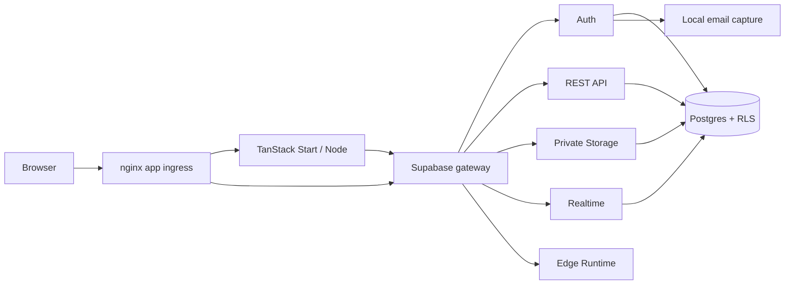

# Supabase local/cloud scaffold

A general starter for **new applications** using Supabase's open-source backend.
Run it locally with Docker Compose, share the application through a configured
public URL when needed, and choose a hosting path later. It has no app-builder or
export/import dependency.

Default frontend: TanStack Start + React on Node.js 22. A static React/Vite adapter
is also available. The backend interfaces are framework-independent: Supabase Auth,
Postgres with RLS, REST API, private Storage, Realtime and Edge Functions. The working
demo has private notes, file uploads and a small authenticated text-analysis function.


## Choose the matching scaffold

| Starting point | Repository |
| --- | --- |
| New app using Supabase Auth, RLS, Storage, Realtime and Functions | [supabase-local-cloud-scaffold](https://github.com/theRealMarkCastillo/supabase-local-cloud-scaffold) |
| Existing exported app whose Supabase interfaces should be retained | [lovable-local-scaffold](https://github.com/theRealMarkCastillo/lovable-local-scaffold) |
| Custom API, OIDC sessions and independently selected data/worker/storage services | [local-cloud-demo](https://github.com/theRealMarkCastillo/local-cloud-demo) |

A worker can also be added to the Supabase starter; it does not automatically require
Redis. The main choice is Supabase's backend API contract versus your own API contract.
Repository links are private and require account access.

Review fixes, checks and scope: [review record](docs/REVIEW.md).

Public/internal URL configuration, tunnels and cloud callback registrations:
[URLs and callbacks](docs/URLS_AND_CALLBACKS.md).

## Start a project

Requirements: Docker/Compose v2, Python 3.11+, make, and enough resources for the
backend. Upstream lists 4 GB RAM minimum and 8 GB+ recommended for the full stack.
No cloud credentials are needed. Never copy an initialized project's .env to another.

```sh
make init
make up
```

Open **http://localhost:8094**. Create an account using an `@example.test` address
and a password with at least eight characters. Read its confirmation email at
**http://localhost:18029**, follow the link and sign in. No seeded demo password.
Mail is captured locally, not sent through a real email provider.

For another fresh copy, choose independent name and free ports before startup:

```sh
python3 scripts/stack.py init --name my-app --port 8096 --admin-port 19806 --mail-port 18031
make up
```

Every instance gets its own credentials, project-scoped volumes/network and localhost
origin. OrbStack is optional. For a configured tunnel or HTTPS hostname, expose only
the app port and run `make origin URL=https://your-app-host`. Never tunnel the raw
backend gateway, Studio, database or email admin interfaces.

## What's included

| Layer | Default | Optional |
| --- | --- | --- |
| Web | TanStack Start/Node, nginx public ingress | Static React/Vite adapter |
| Data/API | Supabase Postgres, RLS, PostgREST | GraphQL exposed by upstream gateway; validate app use separately |
| Identity | Supabase Auth, local email/password and PKCE confirmation | Google/Apple, Keycloak/OIDC federation, real SMTP |
| Files/events | Private Storage, image proxy, Realtime | External S3-compatible storage after explicit configuration |
| Backend code | Deno Edge Runtime and authenticated example function | Additional per-function policies, shared modules and Deno maps |
| Tools | Mailpit, versioned SQL, smoke and source checks | Studio/meta via admin profile, pooler profile |
| Operations | Scoped start/stop, private env/runtime configuration | Workers/queues, cron, observability and hosted infrastructure |



Supabase Auth already handles identity. Redis and Keycloak are not required services
for every project. The [optional-modules comparison](docs/OPTIONAL_MODULES.md) explains
what Supabase covers first, when an addition is justified, and what operating it adds.
Queues/cron and other available capabilities still need explicit setup and testing.

## Daily development

```sh
make migration NAME=add_projects    # New timestamped SQL file
make migrate                       # Apply pending SQL to this local database
make function NAME=hello-user      # New function with a signed-in-user check
make up                            # Rebuild app / load changed function source
make test                          # Offline configuration/source regression checks
make integration                   # Disposable local migration database checks
make check                         # Validate all local Compose profiles
make smoke                         # Synthetic Auth/RLS/files/function/logout/SSR checks
make admin                         # Optional Studio and database metadata UI
make down                          # Stop this project; keep its data
```

`make up` also applies pending application migrations. There is deliberately no
automatic destructive reset. Dashboard edits should be captured in reviewed SQL.
Never edit an applied migration: create the next one. [Development workflow](docs/DEVELOPMENT.md).

Studio uses the loopback gateway port **19804** and generated DASHBOARD_USERNAME /
DASHBOARD_PASSWORD in the ignored .env. These are separate from application accounts.
That gateway remains an administrative surface even when Studio is off.

`make frontend KIND=vite` selects the static example; `KIND=tanstack` selects SSR.
Both use the same backend. The server renders a signed-out shell; user sessions in
this reference are browser-managed. Authenticated SSR needs request-scoped session
verification before any private server data is added.

## Cloud choices

1. Run the same app image on Fly/Render with **managed Supabase** for the backend.
2. Run the open-source backend on a **persistent VM/VPS** with backups, HTTPS,
   monitoring and an upgrade plan; host the app there or separately.
3. Keep everything local for intermittent work and expose only the app for demos.

App-only Fly/Render templates and hosted Compose examples are included; no cloud
resources are created by normal commands. They do not deploy the full backend or
turn development settings into production configuration. [Hosting guide](docs/CLOUD.md).

## Repository map and boundaries

- `supabase/migrations/`: authoritative application SQL, grants and RLS.
- `supabase/functions/` + `supabase/config.toml`: function source and JWT/map policies.
- `scripts/`: initialization, SQL migration execution, function preparation and smoke.
- `web/`: shared React workbench and optional static adapter.
- `web-tanstack/`: SSR routes/server function, Node image and ingress configuration.
- `vendor/supabase/`: unchanged pinned official Docker distribution; provenance/license retained.
- `.env`, `.env.functions`, `.runtime/`: local secrets/state, ignored and excluded from images.

The pinned local stack uses its legacy HS256 key path. Current upstream supports
asymmetric signing/new API keys; adoption and rotation need a coordinated tested
upgrade before using that path. Local development is not production hardening.
Read [security](docs/SECURITY.md), [hosting](docs/CLOUD.md),
[validation](docs/VALIDATION.md), and [upstream provenance](vendor/UPSTREAM.md).

## Email capture and recovery checks

```sh
make email-config   # Apply local Auth/Mailpit settings; already included in make up
make email-test     # Capture a synthetic signup confirmation
make email-smoke    # Verify confirmation and backend password recovery/login
```

See [EMAIL.md](docs/EMAIL.md) for the shared command contract, inbox address, cloud
SMTP configuration and the distinction between backend recovery and application UI.
